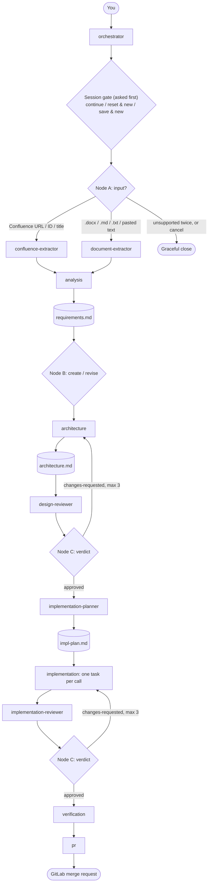

# Agentic SDLC Copilot

Takes a user story from **Confluence** or a **document** (`.docx`, `.md`, `.txt`, or pasted text) and drives it through
the full software delivery lifecycle — requirements → architecture → design review →
implementation plan → implementation → code review → verification → GitLab merge request — using
GitHub Copilot customizations in VS Code: custom agents, subagents, agent skills, prompt
files, instructions, hooks, and MCP servers. A human approves every important step.

---

## 1. How it works

You talk to one agent, **`orchestrator`**. It never does domain work. For every step it:

1. Resolves the session's file paths (`session-store` skill).
2. Scores how hard the step is and picks a model (`model-router` skill).
3. Runs the right specialist as a **subagent** on that model, passing file paths, not file contents.
4. Asks you anything the specialist needs, checkpoints the result, and shows a status line.



Human checkpoints: Step 1 (clarifying questions + approve requirements), Step 3 (design
sign-off), Step 5 (approve every diff), Step 6 (code-review sign-off).

### Starting a run

1. **Session question first** — before reading any file, `orchestrator` asks: *Continue*,
   *Reset and start new*, or *Save and start new*. Sessions are only read after you answer,
   and only as much as that choice needs.
2. **Input question second** — *Confluence page URL / ID / `confluence: <title>`*, a
   *document path*, or *pasted story text*.
3. **Unsupported input** (Jira keys, PDFs, spreadsheets, other URLs, missing files, paths
   outside the workspace, very short text) → it explains why and asks once more. A second
   unsupported answer, "cancel", or a failed extraction you choose not to retry **closes the
   pipeline gracefully**: the session is marked `lastStep: "closed"` with a reason, nothing is
   guessed, and choosing *Continue* later resumes at the input question.

## 2. Building blocks

Each concern is defined **once** (DRY). Agents say *who* acts; skills say *how* decisions are made.

| Piece | Location | Role |
|---|---|---|
| Custom agents | `.github/agents/*.agent.md` | `orchestrator` (user-facing) + 10 specialists (`user-invocable: false`, subagent-only) |
| Skills | `.github/skills/*/SKILL.md` | Loaded on demand — the only place pipeline rules live |
| Prompt files | `.github/prompts/0N-*.prompt.md` | `/01-requirements` … `/08-pr` — jump to a step, always via `orchestrator` |
| Instructions | `.github/copilot-instructions.md`, `.github/instructions/` | Always-on guardrails: security, testing, docs style, no fabrication |
| Hooks | `hooks:` in `orchestrator.agent.md` → `.github/hooks/session-save.js` | `SubagentStop` writes an audit log |
| MCP servers | `.vscode/mcp.json` | Confluence (read-only), workspace-scoped Git; secrets via `${input:...}` |
| Session state | `sessions/<id>/state.json`, `sessions/<id>/output/` | Per-run state and deliverables, isolated per session |

| Skill | Single source of truth for |
|---|---|
| `session-store` | Ask-first session gate, `state.json` shape, checkpoints, output paths, stub templates |
| `decision-router` | Node A (input classification + graceful close), Node B (create/revise), Node C (review loop, cap 3) |
| `model-router` | Model tiers, effort scoring, per-agent floor/ceiling — the only file naming models |
| `pipeline-contracts` | Specialist I/O: paths, result block, extraction shape, verdict format |
| `extract-confluence` / `extract-word` | Field mapping from Confluence / documents to the extraction shape |
| `checklist-generator` | The 7-area code-review checklist (used by review and PR) |

## 3. Dynamic model routing (token economy)

No agent pins a `model:`. Before every delegation, `orchestrator` applies the `model-router`
skill and passes the chosen model to `runSubagent`:

| Tier | Default models | Typical work |
|---|---|---|
| `fast` | GPT-5 mini → GPT-4.1 | Extraction, PR body, small single-file tasks, running tests |
| `standard` | Claude Sonnet 4.5 → GPT-5 | Requirements, typical design and code |
| `reasoning` | Claude Opus 4.5 → GPT-5.2 | Large/risky design, auth/payments/PII code, repeated review failures |

- **Effort score (0–10)** from size, breadth, risk keywords, ambiguity, and rework count:
  0–2 → `fast`, 3–5 → `standard`, ≥ 6 → `reasoning`.
- **Clamped per agent** (e.g. `pr` is always `fast`; reviewers never go below `standard`).
- **Per task in Step 5** — a config tweak and an auth flow in the same plan run on different models.
- **Escalates** one tier after a failed review loop or a malformed result.
- **Your chat model is the cost ceiling.** VS Code won't run a subagent on a model costlier than
  the one selected in the chat model picker; the router falls back and tells you.
- Every choice is logged to `state.json.modelRouting` and shown in the status line.

To change models or thresholds, edit only [`.github/skills/model-router/SKILL.md`](.github/skills/model-router/SKILL.md).
Other token savers: skills load only when needed, specialists get paths instead of pasted
documents, and subagents keep intermediate work out of the main chat context.

## 4. Prerequisites

- VS Code (latest) signed in with GitHub Copilot; custom agents, subagents, skills, and hooks
  enabled (`chat.useHooks` on, workspace trusted).
- **Node.js** on PATH (`.docx` conversion and hooks).
- **uv** on PATH (`uvx` runs the `mcp-atlassian` server) — `pip install uv` or
  `winget install astral-sh.uv`.
- A Confluence account with an API token, or use the OAuth alternative below (not needed for document input).
- GitLab CLI (`glab`) on PATH and authenticated to your company GitLab host for Step 8. The user
  provides the target project URL; the pipeline workspace itself needs no remote.
- Open **this folder** (`agentic-sdlc-pipeline/`) as the workspace root — `.github/` and
  `.vscode/` discovery depend on it.

## 5. Configure Confluence as the input source

All MCP wiring is in [`.vscode/mcp.json`](.vscode/mcp.json). The `confluence` server runs
`mcp-atlassian` in **read-only** mode with only `confluence_search` and `confluence_get_page`
enabled.

1. Create an API token at <https://id.atlassian.com/manage-profile/security/api-tokens>.
2. Command Palette → **MCP: List Servers** → `confluence` → **Start**.
3. VS Code prompts for each input once:

   | Input | Example |
   |---|---|
   | `confluence-url` | `https://your-site.atlassian.net/wiki` |
   | `atlassian-email` | `you@company.com` |
   | `confluence-api-token` | *(masked, stored in the OS credential store)* |
   | `confluence-spaces` | `ENG,PRD` — limits which spaces the agent can read |

4. Confirm the server shows **Running** with 2 tools.

Variations — change only `mcp.json`:
- **Confluence Server / Data Center**: replace `CONFLUENCE_USERNAME` + `CONFLUENCE_API_TOKEN`
  with `CONFLUENCE_PERSONAL_TOKEN` backed by a `password: true` input.
- **OAuth, no token (Cloud)**: use the commented `atlassian` remote server and set
  `confluence-extractor`'s tools to `atlassian/*`.
- **Supply chain**: pin the server version, e.g. `"args": ["mcp-atlassian==<version>"]`.

Secrets never appear in the repo, chat, or agent-readable files — see
[`RUNBOOK.md`](RUNBOOK.md#secrets) for how `${input:...}` storage works.

## 6. Run the pipeline

1. **Developer: Reload Window** so VS Code discovers `.github/agents`, `prompts`, and `skills`.
2. In Chat, pick **`orchestrator`** from the agent picker. Pick the model that should be your
   **cost ceiling** (e.g. Claude Sonnet 4.5 to cap spend, or a reasoning model to allow it).
3. Say **"Let's start"** (or run `/01-requirements`).
4. Follow the prompts:

| # | Prompt | You do | Output in `sessions/<id>/output/` |
|---|---|---|---|
| 0 | — | Answer the session question: continue / reset and start new / save and start new | `state.json` |
| 1 | `/01-requirements` | Give a Confluence page or document path (or paste text); answer clarifying questions; approve | `requirements.md` |
| 2 | `/02-architecture` | Review | `architecture.md` |
| 3 | `/03-design-review` | Sign off (auto-loops up to 3× on `changes-requested`) | `design-review.md` |
| 4 | `/04-impl-plan` | Review order and blocked tasks | `impl-plan.md` |
| 5 | `/05-implementation` | Approve each task's diff | code in the project tree |
| 6 | `/06-review` | Sign off (auto-loops up to 3×) | `implementation-review.md` |
| 7 | `/07-verify` | Check real test output | `verification-report.md`, `test-cases.md` |
| 8 | `/08-pr` | Select the target GitLab project and confirm the exact staged file list | `pr.md` + merge request containing only `generated/<story-slug>/` |

Step 8 verifies the authenticated GitLab identity with `glab`, prepares the change in a separate
clone, and asks for confirmation before publishing. Only generated project files are staged; the
merge request title begins with `[AI-Generated]`. Git initialization in the generated project
does not configure a remote or push anything by itself.

No Atlassian account yet? Answer the input question with `input/sample-user-story.docx`.

Each status line shows the model tier used, e.g.
`✔ Step 2 · architecture · standard (Claude Sonnet 4.5, score 4) · architecture.md v1 · next: design review`.

## 7. Where to change what

| To change… | Edit only |
|---|---|
| Models, tiers, effort thresholds | `.github/skills/model-router/SKILL.md` |
| Review-loop cap, accepted inputs, close behavior | `.github/skills/decision-router/SKILL.md` |
| Session questions, state shape, stubs | `.github/skills/session-store/SKILL.md` |
| Specialist input/output format | `.github/skills/pipeline-contracts/SKILL.md` |
| Source field mapping | `.github/skills/extract-*/SKILL.md` |
| Review checklist | `.github/skills/checklist-generator/SKILL.md` |
| MCP servers and credentials | `.vscode/mcp.json` |
| What a specialist does | that agent's `.agent.md` |

## 8. Folder structure

```
.github/
  copilot-instructions.md   always-on repo rules
  agents/                   orchestrator + 10 specialist subagents
  skills/                   pipeline rules (see §2)
  prompts/                  /01-requirements … /08-pr
  instructions/             security, testing, docs-style guardrails
  hooks/                    session-save.js (audit log)
.vscode/mcp.json            Confluence and workspace-scoped Git MCP servers
.gitlab-ci.yml              GitLab CI for the generated project's test suite
input/                      user-story documents (.docx, .md, .txt)
sessions/                   index.json + one folder per run (state.json, output/)
CHANGELOG.md                pipeline changelog; not included in generated-artifact PRs
RUNBOOK.md                  secrets and troubleshooting
```

Troubleshooting: [`RUNBOOK.md`](RUNBOOK.md#troubleshooting).
